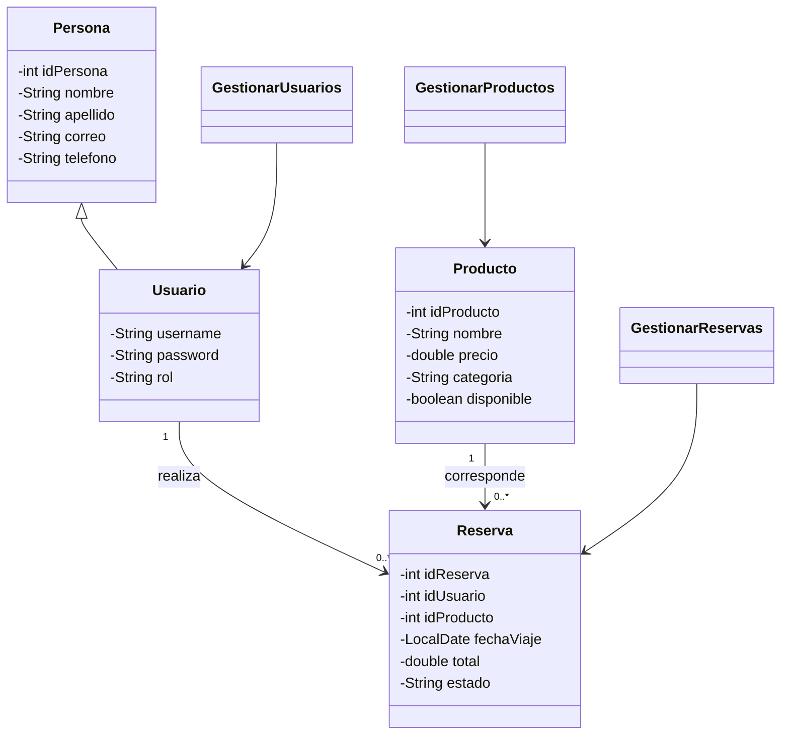

# EcoTravelSmart - entrega final

## Requisitos funcionales actualizados
RF01: Registrar usuarios con identificador único y validación de campos.
RF02: Autenticar usuarios y permitir cierre de sesión.
RF03: Administrar usuarios: crear, listar, buscar, editar y eliminar.
RF04: Administrar productos turísticos: crear, listar, filtrar, editar, eliminar y cambiar disponibilidad.
RF05: Registrar reservas que asocian un Usuario con un Producto.
RF06: Consultar reservas propias y administrar estados según rol.
RF07: Conservar usuarios, productos y reservas en archivos de texto entre reinicios.
RF08: Generar reporte.txt con cliente, producto, fecha, personas, total y estado.
RF09: Restringir pantallas administrativas al rol Administrador.

## Arquitectura MVC
Vista: index.jsp, login.jsp, registroUsuarios.jsp, adminUsuarios.jsp, registroProductos.jsp, adminProductos.jsp, productos.jsp, misReservas.jsp.
Modelo: Persona, Usuario, Producto, Reserva y clases GestionarUsuarios, GestionarProductos, GestionarReservas.
Controladores: LoginServlet, LogoutServlet, UsuarioServlet, ProductoServlet, ReservaServlet.
Filtro: AuthFilter.
Persistencia: util/Persistencia.java.

## Diagrama de clases (Mermaid)

## Archivos de datos
Por defecto se guardan en `<carpeta de usuario>/ecotravelsmart-data`.
Configurar carpeta mediante variable de entorno `ECOTRAVEL_DATA_DIR` o propiedad Java `-Decotravel.data.dir=/ruta`.
Se generan `usuarios.txt`, `items.txt`, `reservas.txt` y `reporte.txt`.
Los campos de texto se codifican en Base64 para evitar conflictos con tabuladores y saltos de línea. **Base64 no cifra ni protege contraseñas.** Los archivos deben estar protegidos por permisos del sistema.
En primer inicio se crean datos de demostración; después se recuperan desde los archivos.
No eliminar archivos sueltos: los tres archivos de datos deben permanecer juntos.

## Guion para video de hasta 12 minutos
0:00-1:00 Presentación del problema y objetivo.
1:00-2:00 Arquitectura MVC y carpetas del proyecto.
2:00-3:00 Diagrama de clases: Usuario, Producto y Reserva.
3:00-4:00 Inicio de sesión y roles.
4:00-5:30 CRUD de usuarios y filtros.
5:30-7:00 CRUD de productos y filtros.
7:00-8:30 Crear una reserva (asociación de clases).
8:30-10:00 Mostrar archivos TXT y reporte.
10:00-11:00 Reiniciar aplicación y comprobar persistencia.
11:00-12:00 Manejo de excepciones, conclusiones y repositorio.

## Pruebas necesarias antes de presentar
1. Crear usuario y producto; reiniciar y comprobar que se mantienen.
2. Editar y eliminar registros; reiniciar y verificar cambios.
3. Crear una reserva y comprobar reporte.txt.
4. Confirmar/cancelar reserva y revisar reporte.
5. Verificar que un cliente no accede a las páginas administrativas.
6. Probar entradas inválidas y comprobar mensajes de error.

## Consideraciones
La guía usa nombres genéricos addUsers.jsp, listUsers.jsp, addItems.jsp y listItems.jsp. El proyecto ya cumple esas funciones con registroUsuarios.jsp, adminUsuarios.jsp, registroProductos.jsp y adminProductos.jsp.
No se ha verificado compilación ni ejecución en servidor. Se recomienda probar con NetBeans y servidor compatible con Jakarta EE 10.
La seguridad de contraseñas y protección CSRF requieren mejoras antes de uso real.
